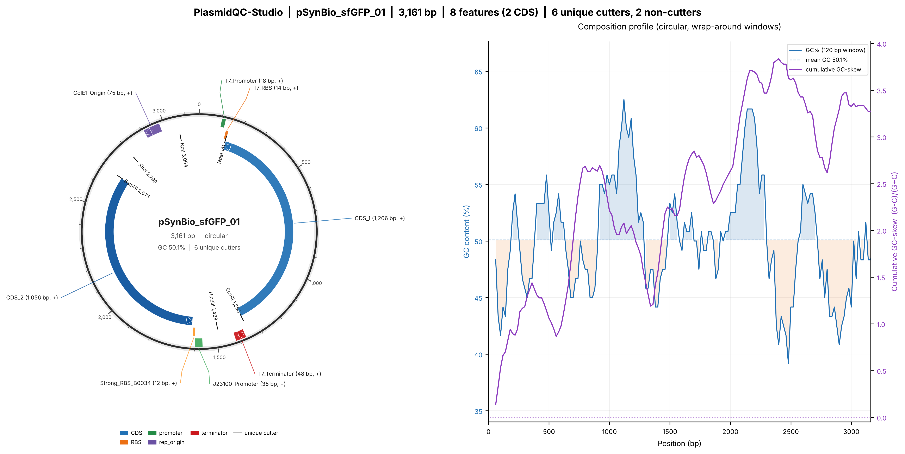

# PlasmidQC-Studio

**Automated circular plasmid annotation, restriction digest QC, and nearest-neighbor primer design.**

[](https://www.python.org/)
[](tests/test_analyzer.py)
[](#license)

PlasmidQC-Studio takes a circular plasmid FASTA and returns the three things
needed before a construct goes to the bench: **what is on the plasmid**, **which
enzymes cut it**, and **which primers will verify it**. Every coordinate is
handled on a true circle, so features and restriction sites that span the
numbering origin are found exactly once rather than silently dropped — the most
common failure mode of linear-sequence tooling applied to plasmids.

The repository ships with two synthetic benchmark plasmids, so the full pipeline
runs out of the box with **zero external downloads and no network access**.

<p align="center">
  
</p>

<p align="center"><em>300-DPI QC dashboard generated by <code>cli.py</code>: circular feature map with
unique-cutter ticks (left) and dual-axis GC / cumulative GC-skew profile (right).</em></p>

---

## Table of contents

- [Why this exists](#why-this-exists)
- [Features](#features)
- [Installation](#installation)
- [Quickstart](#quickstart)
- [Command-line interface](#command-line-interface)
- [Interactive web app](#interactive-web-app)
- [Benchmark results](#benchmark-results)
- [Methods](#methods)
- [Python API](#python-api)
- [Testing](#testing)
- [Repository layout](#repository-layout)
- [Limitations](#limitations)
- [License](#license)

---

## Why this exists

Routine plasmid QC is a sequence of small, error-prone manual steps: eyeball the
map for an ORF, hunt for a unique cutter in a vendor table, paste a primer into a
web Tm calculator that uses a different salt model than the next one. Each step is
trivial; doing all of them reproducibly for every construct is not.

PlasmidQC-Studio collapses the workflow into a single reproducible command whose
outputs are plain CSV — diffable, version-controllable, and reviewable — plus a
publication-quality figure suitable for a lab notebook or a thesis chapter.

Three design decisions distinguish it from a weekend script:

1. **Circularity is a first-class property, not an afterthought.** ORFs,
   motifs, restriction sites, GC windows, and amplicons all wrap the origin.
2. **Shadow ORFs are filtered.** A naive 6-frame scan reports every internal
   in-frame ATG as its own "gene"; this pipeline collapses them into one primary
   CDS call per locus (see [Methods](#methods)).
3. **Thermodynamics, not rules of thumb.** Melting temperatures come from the
   SantaLucia (1998) unified nearest-neighbor parameter set with salt and strand
   concentration corrections — not the `4 × GC + 2 × AT` approximation, which
   diverges by >10 °C for the AT-rich flanks common around T7 elements.

---

## Features

| Module | Capability |
|---|---|
| `src/analyzer.py` | Reverse complement, GC content, circular sliding GC / GC-skew |
| | 6-frame circular ORF finder with nested/shadow-ORF filtering |
| | Curated part scanner: origins, promoters, RBSs, terminators |
| | Restriction audit: 6 Type IIP enzymes + 2 Type IIS Golden Gate enzymes |
| | SantaLucia (1998) nearest-neighbor Tm, GC-clamp and ΔTm QC |
| `src/visualizer.py` | 300-DPI two-panel dashboard: circular map + composition profile |
| `cli.py` | Batch pipeline exporting 3 CSVs and 1 PNG per plasmid |
| `app.py` | Streamlit app: upload, interactive thresholds, live tables and figure |
| `tests/` | 57 pytest tests: analytical core + Streamlit app smoke tests |

---

## Installation

**Option A — conda (recommended, reproducible):**

```bash
git clone https://github.com/DhruvASharma2004/PlasmidQC-Studio.git
cd PlasmidQC-Studio
conda env create -f environment.yml
conda activate plasmidqc
```

**Option B — pip / venv:**

```bash
git clone https://github.com/DhruvASharma2004/PlasmidQC-Studio.git
cd PlasmidQC-Studio
python -m venv .venv && source .venv/bin/activate   # Windows: .venv\Scripts\activate
pip install -r requirements.txt
```

Dependencies are deliberately minimal: `numpy`, `pandas`, `matplotlib`,
`streamlit`, `pytest`. The analytical core (`src/analyzer.py`) is pure standard
library and can be imported without a plotting stack.

---

## Quickstart

```bash
# Run the full pipeline on the bundled benchmark plasmid
python cli.py --fasta data/pSynBio_sfGFP_01.fasta

# Launch the interactive app
streamlit run app.py

# Run the test suite
pytest -q
```

Expected CLI output:

```text
[1/4] loaded pSynBio_sfGFP_01: 3,161 bp, GC 50.11%
[2/4] annotated 8 features (2 CDS) -> results/pSynBio_sfGFP_01_annotations.csv
[3/4] digest audit: 6 unique, 0 multi-cutter, 2 non-cutter -> results/pSynBio_sfGFP_01_restriction_digest.csv
[4/4] designed 5 primer pairs (5 Tm-balanced) -> results/pSynBio_sfGFP_01_verification_primers.csv
      dashboard -> results/pSynBio_sfGFP_01_map_dashboard.png
done.
```

---

## Command-line interface

```bash
python cli.py --fasta <PATH> [--outdir results] [--min-orf 100]
              [--window 120] [--step 20] [--flank 60] [--no-plot]
```

| Flag | Default | Meaning |
|---|---|---|
| `--fasta` | *(required)* | Single-record circular plasmid FASTA |
| `--outdir` | `results` | Output directory (created if absent) |
| `--min-orf` | `100` | Minimum ORF length in amino acids |
| `--window` | `120` | Sliding-window width (bp) for GC / skew |
| `--step` | `20` | Sliding-window step (bp) |
| `--flank` | `60` | Bases of context outside each feature for primers |
| `--no-plot` | off | Skip figure rendering (CSV exports only) |

Four artifacts are written per plasmid:

```text
results/
├── <name>_annotations.csv            # curated parts + primary CDS calls
├── <name>_restriction_digest.csv     # Type IIP / Type IIS cutter audit
├── <name>_verification_primers.csv   # NN-thermodynamic verification primers
└── <name>_map_dashboard.png          # 300-DPI two-panel figure
```

Batch an entire plasmid collection:

```bash
for f in data/*.fasta; do python cli.py --fasta "$f" --outdir results; done
```

---

## Interactive web app

```bash
streamlit run app.py
```

- Upload any plasmid FASTA, or start from either bundled benchmark.
- Move the **minimum ORF length** slider to see shadow-ORF filtering in action:
  dropping the threshold to 30 aa exposes small ORFs, raising it to 300 aa keeps
  only the major coding sequences.
- Tune the primer flank and GC window and watch the dashboard re-render live.
- Browse interactive `st.dataframe` tables for features, the digest audit, and
  verification primers; download any of them as CSV, or the figure as a 300-DPI
  PNG.
- The Golden Gate banner turns green only when **both** BsaI and BsmBI are
  absent from the backbone.

---

## Benchmark results

Two synthetic circular plasmids (~3.16 kb) ship in `data/`. They embed real
synthetic-biology part consensus sequences, deliberately placed unique cutters,
and two ORFs apiece — including, in the second plasmid, a **reverse-strand CDS**
to exercise strand handling end to end.

### `pSynBio_sfGFP_01` — 3,161 bp, GC 50.11%

T7 and J23100 expression cassettes, sfGFP-sized and secondary CDS, both on the
plus strand.

**Annotated features** (`results/pSynBio_sfGFP_01_annotations.csv`)

| name | feature_type | start | end | strand | length_bp | gc_percent | notes |
|:---|:---|---:|---:|:---|---:|---:|:---|
| T7_Promoter | promoter | 101 | 118 | + | 18 | 33.33 | curated motif match |
| T7_RBS | RBS | 130 | 143 | + | 14 | 28.57 | curated motif match |
| CDS_1 | CDS | 144 | 1349 | + | 1206 | 51.58 | frame +3; 401 aa |
| T7_Terminator | terminator | 1370 | 1417 | + | 48 | 52.08 | curated motif match |
| J23100_Promoter | promoter | 1566 | 1600 | + | 35 | 54.29 | curated motif match |
| Strong_RBS_B0034 | RBS | 1601 | 1612 | + | 12 | 33.33 | curated motif match |
| CDS_2 | CDS | 1619 | 2674 | + | 1056 | 51.14 | frame +2; 351 aa |
| ColE1_Origin | rep_origin | 2909 | 2983 | + | 75 | 44.00 | curated motif match |

**Restriction / Golden Gate audit** (`results/pSynBio_sfGFP_01_restriction_digest.csv`)

| enzyme | site | class | n_sites | verdict | position | Golden Gate ready |
|:---|:---|:---|---:|:---|---:|:---|
| BamHI | GGATCC | Type IIP | 1 | Unique Cutter | 2675 | — |
| EcoRI | GAATTC | Type IIP | 1 | Unique Cutter | 1350 | — |
| HindIII | AAGCTT | Type IIP | 1 | Unique Cutter | 1488 | — |
| NdeI | CATATG | Type IIP | 1 | Unique Cutter | 141 | — |
| NotI | GCGGCCGC | Type IIP | 1 | Unique Cutter | 3064 | — |
| XhoI | CTCGAG | Type IIP | 1 | Unique Cutter | 2799 | — |
| BsaI | GGTCTC | Type IIS | 0 | Non-cutter | — | ✅ |
| BsmBI | CGTCTC | Type IIS | 0 | Non-cutter | — | ✅ |

Six independent unique cutters and a fully domesticated Type IIS backbone: the
plasmid is directly usable as a Golden Gate destination vector. Note the NdeI
site at 141 — it arises where the T7 g10 RBS (`…ACAT`) meets the CDS_1 start
codon (`ATG`), the canonical `CATATG` overlap, and the scanner recovers it
without it being annotated as a part.

**Verification primers** (`results/pSynBio_sfGFP_01_verification_primers.csv`)

| target | role | sequence (5'→3') | len | GC% | Tm (°C) | 3' clamp | amplicon | ΔTm | verdict |
|:---|:---|:---|---:|---:|---:|:---|---:|---:|:---|
| T7_Promoter | F | `TTCTTATGCGCTGTCTTCGTGC` | 22 | 50.00 | 59.77 | ✅ | 138 bp | 0.45 | PASS (with flags) |
| T7_Promoter | R | `GGGTTGCTCAAGTTCGGGC` | 19 | 63.16 | 60.22 | ✅ | | | |
| CDS_1 | F | `GTATAGCATAGTAATCGTAATACGAC` | 26 | 34.62 | 52.75 | ✅ | 1,326 bp | 0.40 | PASS (with flags) |
| CDS_1 | R | `CCCTCAAGACCCGTTTAG` | 18 | 55.56 | 53.15 | ✅ | | | |
| J23100_Promoter | F | `GCTACGCGTATGTCCCCAAC` | 20 | 60.00 | 59.53 | ✅ | 155 bp | 0.56 | **PASS** |
| J23100_Promoter | R | `CTTGATCATTTCCCCATCGCAACC` | 24 | 50.00 | 60.09 | ✅ | | | |
| CDS_2 | F | `AGTGCTTTTGACGGCTAGCTC` | 21 | 52.38 | 59.08 | ✅ | 1,176 bp | 0.58 | **PASS** |
| CDS_2 | R | `AATTGCTACGGTTGGTCGCC` | 20 | 55.00 | 59.66 | ✅ | | | |
| ColE1_Origin | F | `GATCTTGACTGTCTTGGAAAGTTTAA` | 26 | 34.62 | 55.12 | ❌ | 195 bp | 0.15 | PASS (with flags) |
| ColE1_Origin | R | `TTTATAAAGTTATGGCTGGTGCG` | 23 | 39.13 | 55.27 | ✅ | | | |

All five pairs are Tm-balanced (ΔTm ≤ 3 °C), so one annealing temperature serves
the whole plate. The flags are informative rather than fatal and show the QC
layer doing its job: the CDS_1 pair sits at ~53 °C because the T7 promoter flank
is strongly AT-rich, and the ColE1 forward primer cannot be given a 3' G/C
without moving off the requested flank. Both are reported, not silently
accepted — exactly the judgement call a bench scientist should be shown rather
than have hidden.

### `pBioBrick_mCherry_AmpR` — 3,163 bp, GC 49.86%

BioBrick-style layout with an mCherry-sized CDS on the plus strand and an
AmpR-sized CDS on the **minus** strand.

| name | feature_type | start | end | strand | length_bp | gc_percent | notes |
|:---|:---|---:|---:|:---|---:|---:|:---|
| J23100_Promoter | promoter | 151 | 185 | + | 35 | 54.29 | curated motif match |
| Strong_RBS_B0034 | RBS | 186 | 197 | + | 12 | 33.33 | curated motif match |
| CDS_1 | CDS | 204 | 914 | + | 711 | 53.73 | frame +3; 236 aa |
| T7_Terminator | terminator | 947 | 994 | + | 48 | 52.08 | curated motif match |
| T7_Promoter | promoter | 1387 | 1404 | + | 18 | 33.33 | curated motif match |
| CDS_2 | CDS | 1597 | 2460 | **−** | 864 | 49.77 | frame −2; 287 aa |
| T7_RBS | RBS | 2461 | 2474 | **−** | 14 | 28.57 | curated motif match |
| ColE1_Origin | rep_origin | 2771 | 2845 | + | 75 | 44.00 | curated motif match |

The reverse-strand cassette is recovered with the correct strand assignment for
both the CDS and its upstream RBS, and the NdeI site at 2458 is detected on the
minus strand at the CDS_2 start codon. Digest audit: 5 unique cutters (EcoRI
915, HindIII 1175, NdeI 2458, XhoI 2625, NotI 3006), BamHI absent, and both
Type IIS enzymes absent — Golden Gate ready. All 5 primer pairs are Tm-balanced.

> Reproduce every table and figure above with:
> `python cli.py --fasta data/pSynBio_sfGFP_01.fasta && python cli.py --fasta data/pBioBrick_mCherry_AmpR.fasta`

---

## Methods

### Circular coordinates

Every scan runs against the doubled sequence `S + S`, with matches constrained
to start within the first copy. This finds origin-spanning features exactly once
and lets a feature's reported span exceed the end of the molecule
(`wraps_origin = True`). Public coordinates are **1-based inclusive**, matching
GenBank, SnapGene, and Benchling.

### ORF finding and shadow-ORF filtering

All six reading frames are scanned for canonical `ATG → TAA/TAG/TGA` ORFs of at
least `min_aa` residues (default 100). A naive scan reports every internal
in-frame `ATG` as a separate ORF, inflating the call set several-fold. Candidates
are therefore sorted longest-first and a candidate is discarded when it is
either fully nested inside an accepted ORF on the same strand, or shares more
than 50% of its own length with one. The survivors are the primary coding
sequences, renumbered `CDS_1`, `CDS_2`, … in ascending coordinate order.

### Restriction and Golden Gate audit

Both strands are scanned. Palindromic Type IIP sites match themselves on the
reverse strand and are counted once per locus; non-palindromic Type IIS sites
(BsaI `GGTCTC`, BsmBI `CGTCTC`) are reported per strand, since orientation
determines where the enzyme cuts outside its recognition sequence. Each enzyme is
classified as **Unique Cutter** (exactly one site — usable for linearisation or
directional cloning), **Multi-cutter (N×)**, or **Non-cutter**. Cut positions are
computed from each enzyme's offset and converted into circular digest fragment
sizes, which sum to the plasmid length.

### Nearest-neighbor thermodynamics

Melting temperatures use the SantaLucia (1998) unified parameter set. Duplex
enthalpy and entropy are summed over the ten unique Watson–Crick nearest-neighbor
dimers, helix-initiation penalties are applied at both termini according to the
identity of the terminal base pair, and the entropy is salt-corrected before the
two-state melting equation is solved:

$$\Delta H^{\circ} = \sum_{i} \Delta H^{\circ}_{\text{NN}(i)} + \Delta H^{\circ}_{\text{init}}$$

$$\Delta S^{\circ}_{[\mathrm{Na^+}]} = \sum_{i} \Delta S^{\circ}_{\text{NN}(i)} + \Delta S^{\circ}_{\text{init}} + 0.368\,(N-1)\,\ln[\mathrm{Na^+}]$$

$$T_m = \frac{\Delta H^{\circ} \times 1000}{\Delta S^{\circ}_{[\mathrm{Na^+}]} + R \ln C_T} - 273.15$$

where $N$ is primer length in nucleotides, $R = 1.987\ \mathrm{cal\,mol^{-1}K^{-1}}$,
$C_T = 250\ \mathrm{nM}$ (total strand concentration), and
$[\mathrm{Na^+}] = 50\ \mathrm{mM}$. Both are configurable per call.

### Primer design

For each target feature a forward primer is placed `flank` bp upstream and a
reverse primer `flank` bp downstream, so the amplicon brackets the whole element
and Sanger reads cover both junctions. Length is optimised from 18–27 nt against
a 60 °C target, scored on |Tm − target| with bonuses for a 3' G/C clamp and
40–60% GC. A second pass then re-designs each primer against its **partner's**
realised Tm: AT-rich flanks cannot always reach 60 °C, and matching the pair to
each other matters more for a single annealing temperature than matching both to
an unreachable ideal. Pairs are flagged `tm_balanced` at |ΔTm| ≤ 3 °C, with
additional advisory flags for GC content outside 40–60%, Tm outside 55–68 °C, a
missing 3' clamp, homopolymer runs ≥ 5, and GC-rich 3' ends.

### Visualization

`plot_plasmid_dashboard` renders a 300-DPI two-panel figure. The left panel is a
circular map: features are assigned to radial tracks by greedy interval-graph
colouring so that overlapping elements (an RBS abutting a CDS) stay individually
visible; labels are pushed apart on each half of the circle and joined to their
arcs by leader lines; unique cutters are drawn as internal radial ticks. The
right panel overlays the sliding-window GC profile (shaded above/below the mean)
with the cumulative GC-skew on a twin axis.

---

## Python API

```python
from src.analyzer import (read_fasta, annotate_plasmid, find_restriction_sites,
                          design_amplicon_primers, calculate_tm_nn)
from src.visualizer import plot_plasmid_dashboard

name, seq = read_fasta("data/pSynBio_sfGFP_01.fasta")

features = annotate_plasmid(seq, min_aa=100)
hits     = find_restriction_sites(seq)
pairs    = design_amplicon_primers(seq, features, flank=60)

unique = [h.enzyme for h in hits if h.n_sites == 1]
print(f"{len(features)} features, unique cutters: {', '.join(unique)}")

for pair in pairs:
    print(f"{pair.target:16s} {pair.amplicon_bp:5d} bp  "
          f"dTm {pair.delta_tm_c:4.2f}  {pair.verdict}")

calculate_tm_nn("GTAAAACGACGGCCAGT", na_conc_m=0.05, primer_conc_m=250e-9)
# -> 53.86 (M13 -21 forward)

plot_plasmid_dashboard(name, seq, features, hits, output_path="map.png")
```

All analytical results are dataclasses (`AnnotatedFeature`, `RestrictionHit`,
`Primer`, `PrimerPair`) with `.as_dict()` / `.as_rows()` helpers for direct
conversion to a `pandas.DataFrame`.

---

## Testing

```bash
pytest -q          # 57 passed
pytest -v          # per-test detail
```

The suite covers the analytical core, not just happy paths:

- **Reverse complement** — involution property, case/whitespace handling,
  palindrome checks for all six Type IIP sites, non-palindromy of BsaI/BsmBI.
- **GC and skew** — extremes, strand symmetry, window/step shapes, verified
  wrap-around behaviour, cumulative skew as a running sum.
- **Restriction detection** — unique/multi/non-cutter verdicts, fragment sizes
  summing to plasmid length, Type IIS strand reporting, and an
  **origin-spanning site** found when circular and correctly absent when linear.
- **Nearest-neighbor Tm** — plausibility for the M13 −21 primer, GC vs AT
  ordering, monotonic length and salt/concentration dependence, strand symmetry,
  and an **independent hand re-derivation** of the published equation for a test
  oligo (agreement to 1e-6).
- **ORF discovery** — plus and minus strands, `min_aa` thresholding, nested
  shadow-ORF collapse, first-in-frame-stop behaviour, and origin-spanning CDS
  calls.
- **Integration** — every annotated span re-extracts its own motif, every CDS
  starts with ATG and ends in a stop codon on the correct strand, and every
  designed primer is an exact substring of one strand of the template.
- **Streamlit app** (`tests/test_app.py`) — the app is executed through
  Streamlit's own `AppTest` harness, so a runtime error in the UI layer fails
  the suite: default load, metric values, the ORF-threshold slider changing the
  call count, the flank and GC-window sliders, the second bundled plasmid, and
  the empty-upload path. Skipped automatically when Streamlit is absent.

---

## Repository layout

```text
PlasmidQC-Studio/
├── src/
│   ├── __init__.py
│   ├── analyzer.py       # sequence analysis, annotation, digest QC, NN thermodynamics
│   └── visualizer.py     # 300-DPI circular map + composition dashboard
├── data/
│   ├── pSynBio_sfGFP_01.fasta
│   └── pBioBrick_mCherry_AmpR.fasta
├── results/              # CLI outputs (git-ignored, regenerate with cli.py)
├── assets/
│   └── pSynBio_sfGFP_01_map_dashboard.png
├── tests/
│   ├── test_analyzer.py  # 51 unit tests over the analytical core
│   └── test_app.py       # 6 Streamlit app smoke tests
├── cli.py                # batch pipeline
├── app.py                # Streamlit web app
├── environment.yml
├── requirements.txt
├── .gitignore
└── README.md
```

---

## Limitations

Stated plainly, because a QC tool that overstates its scope is worse than none:

- **The part scanner is curated, not exhaustive.** It recognises the six part
  families in `PART_MOTIFS`; it is not a replacement for a full annotation
  database such as SnapGene's or Addgene's. Extend `PART_MOTIFS` to add parts.
- **ORF calls are structural, not homology-based.** An ORF is not evidence of a
  functional gene; no BLAST or HMM search is performed.
- **The restriction panel covers eight enzymes.** Add entries to
  `RESTRICTION_ENZYMES` for others; methylation sensitivity (Dam/Dcm) and star
  activity are not modelled.
- **Primer design does not model secondary structure.** Hairpins, self-dimers,
  and primer-dimers are not predicted, and specificity is not checked against a
  host genome. Pass candidates through a dimer checker and an *in silico* PCR
  against your host before ordering.
- **Benchmark data are synthetic.** The bundled plasmids are generated to
  exercise the pipeline deterministically; they are not derived from, and should
  not be substituted for, real vector sequences.

---

## License

MIT — see `LICENSE`. Benchmark data in `data/` are synthetic and free of
third-party sequence rights.

## Citation

If this tool contributes to published work, please cite the nearest-neighbor
parameter set it depends on:

> SantaLucia J Jr. (1998) A unified view of polymer, dumbbell, and oligonucleotide
> DNA nearest-neighbor thermodynamics. *PNAS* 95(4):1460–1465.
